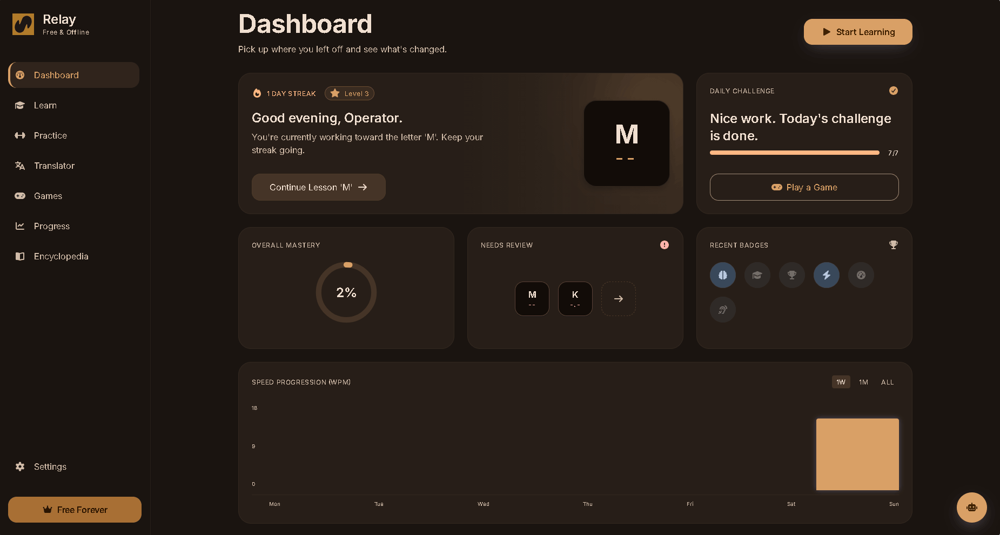
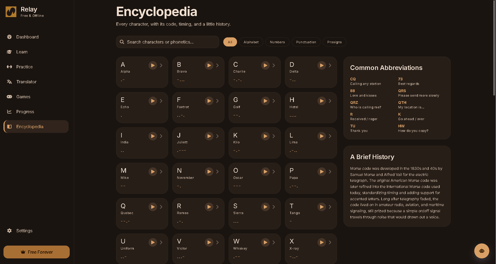
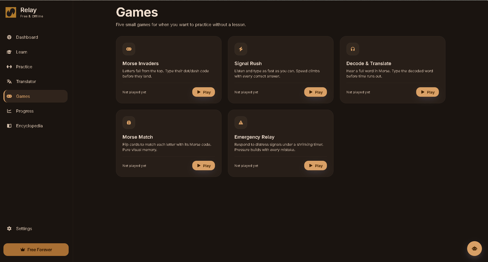
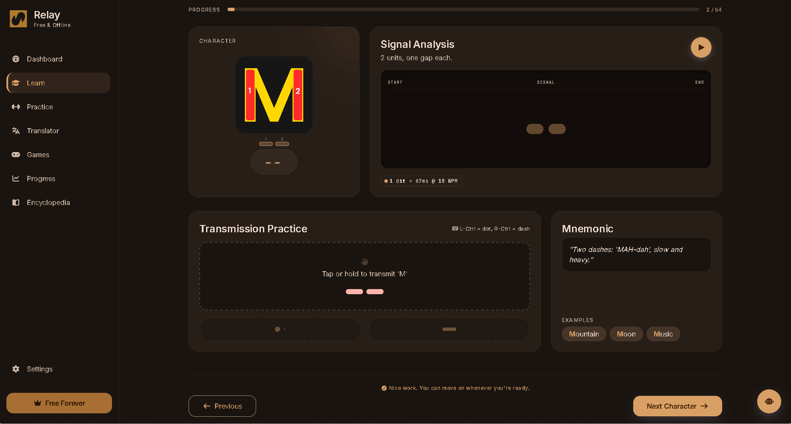
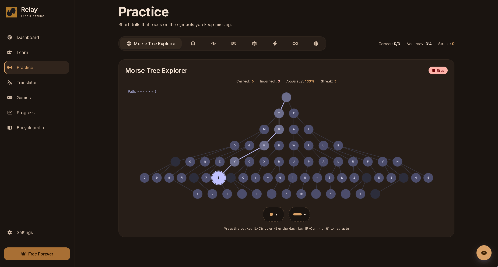
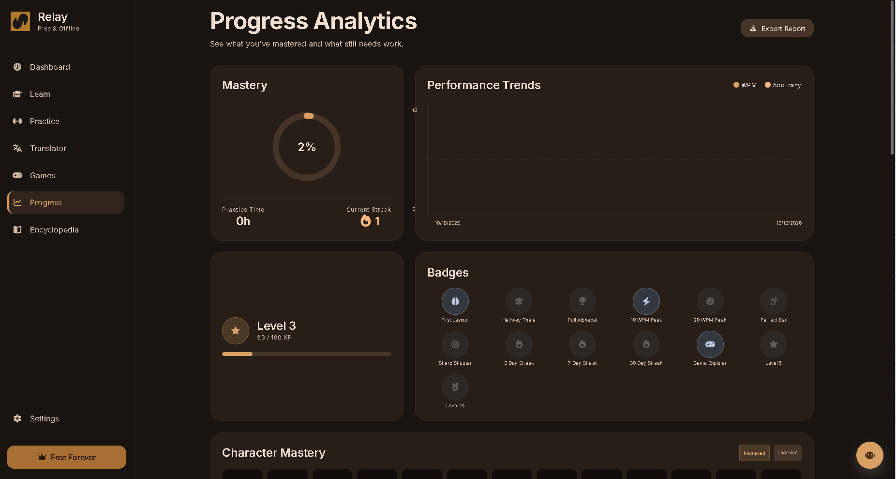
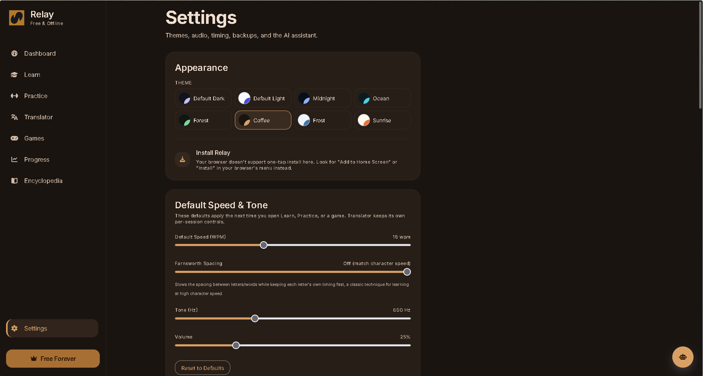
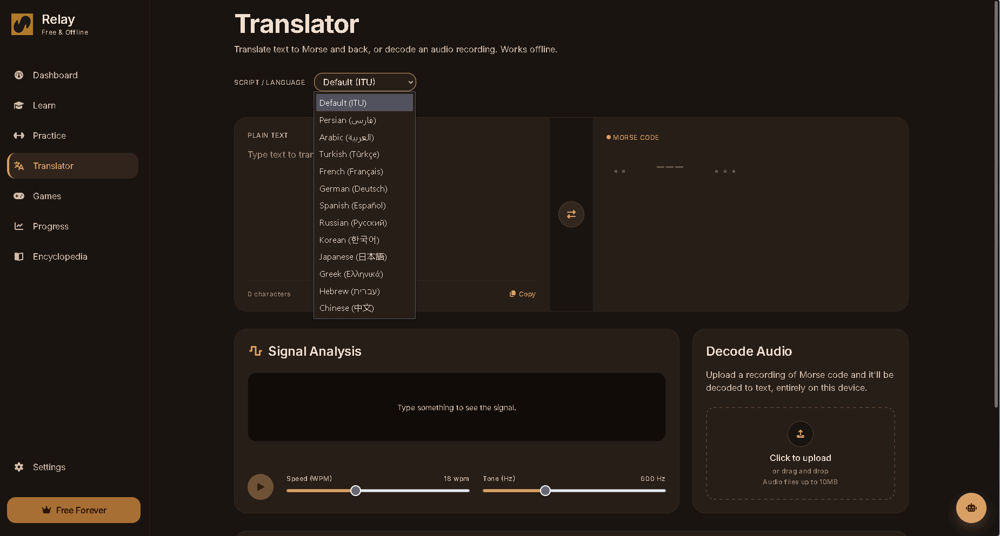

<div align="center">

  

  <h1>Relay</h1>

  <p><strong>Learn Morse. Hear the signal. Build the skill.</strong></p>
  <p>An offline-first Morse code learning platform for structured lessons, deliberate practice, audio tools, games, and progress tracking.</p>

  <p>
    <a href="https://github.com/mh3nj/Relay/actions/workflows/ci.yml"></a>
    <a href="https://github.com/mh3nj/Relay/blob/main/LICENSE"></a>
    <a href="https://www.typescriptlang.org/"></a>
    <a href="https://react.dev/"></a>
    <a href="https://github.com/mh3nj/Relay/issues"></a>
    <a href="https://github.com/mh3nj/Relay/commits/main"></a>
  </p>

  <p>
    <a href="https://github.com/mh3nj/Relay/issues">Issues</a> ·
    <a href="SECURITY.md">Security</a> ·
    <a href="docs/PRIVACY.md">Privacy & data</a> ·
    <a href="CONTRIBUTING.md">Contributing</a>
  </p>
</div>

---

## Links


[Live Demo](https://relay-woad-theta.vercel.app/)

[Landing Page](https://mh3nj.github.io/Relay/relay-landing.html)

---

## Overview

Relay is a browser-based Morse code learning environment built around a repeatable loop: learn a signal, practise recognition or transmission, review difficult material, and use progress history to guide the next session.

It goes beyond a simple text-to-Morse converter by bringing lessons, practice drills, games, audio decoding, a reference encyclopedia, and personal progress into one installable Progressive Web App (PWA).

> **Project status:** The source code, screenshots, and demo recording are available in this repository. The hosted demo and static landing page are linked above; build and deployment behavior can vary by hosting environment.


## Features

| Area | What it offers |
| --- | --- |
| **Learn** | Incremental character learning, Koch-style progression, mnemonic aids, and signal exploration |
| **Practice** | Speed, endless, flashcard, hear-and-type, memory, read-and-type, and translation drills |
| **Games** | Morse Invaders, Signal Rush, Decode & Translate, Morse Match, and Emergency Relay |
| **Translator** | Text/Morse conversion, custom dictionaries, and export tools |
| **Audio tools** | Audio-file decoding, signal analysis, Morse audio playback, and WAV generation |
| **Progress** | XP, levels, streaks, badges, character mastery, review scheduling, mistake tracking, and WPM trends |
| **Reference** | Searchable character information and prosigns |
| **Personalisation** | Multiple interface languages, light/dark themes, audio and timing controls, and accessibility preferences |
| **Offline-first design** | PWA installation and cached app resources after the app has been loaded successfully |
| **Data portability** | Browser-local persistence and JSON backup/import tools |
| **Optional AI helper** | User-configured provider integration; separate from the core local learning workflow |

Feature availability and browser behavior can vary by environment. Audio decoding depends on recording quality and signal conditions; it should not be treated as guaranteed for every file.

## Screenshots and demo

[▶ Watch the Relay demo (WebM)](https://github.com/user-attachments/assets/7fdf93a5-1998-49e1-8e85-defeb73d13eb)


<table>
  <tr>
    <td width="50%" align="center" valign="top">
      
    </td>
    <td width="50%" align="center" valign="top">
      
    </td>
  </tr>
  <tr>
    <td width="50%" align="center" valign="top">
      
    </td>
    <td width="50%" align="center" valign="top">
      
    </td>
  </tr>
  <tr>
    <td width="50%" align="center" valign="top">
      
    </td>
    <td width="50%" align="center" valign="top">
      
    </td>
  </tr>
  <tr>
    <td width="50%" align="center" valign="top">
      
    </td>
    <td width="50%" align="center" valign="top">
      
    </td>
  </tr>
</table>

## Privacy and data handling

Relay is designed to work without a Relay account or application-owned backend in the supplied source. Application data is primarily stored in the browser, and backup/export tools are available for portability.

Important distinctions:

- Browser-local storage is associated with the browser profile and origin; clearing site data can remove it.
- Private/incognito sessions, browser storage limits, and device loss can affect persistence.
- Optional AI features require network access and send the relevant request to the provider configured by the user. Review that provider's policies before enabling it.
- Do not place secrets, passwords, or sensitive personal information in custom dictionaries, prompts, or backups.
- This repository's privacy guide describes the intended behavior and should be checked against the exact release build.

Read [Privacy & data](docs/PRIVACY.md) for more detail.

## Technology

The supplied project is built with:

- React and TypeScript
- Vite
- Tailwind CSS
- React Router
- i18next / react-i18next
- IndexedDB utilities through idb
- Vitest and Testing Library
- Vite PWA tooling

The exact scripts and dependency versions are recorded in `package.json` and `package-lock.json`.

## Run locally

Prerequisites: a current Node.js LTS release compatible with the Vite version in the lockfile, plus npm.

```bash
git clone https://github.com/mh3nj/Relay.git
cd Relay
npm ci
npm run dev
```

Vite prints the local development URL in the terminal. Open that URL in a modern browser.

### Available scripts

```bash
npm run dev       # Start the local development server
npm run build     # Type-check and create a production build
npm run preview   # Preview the production build locally
npm test          # Run the test suite once
npm run test:watch
npm run lint
```

Run verification from a clean checkout before treating a build as release-ready. Results may depend on the installed Node.js/npm versions and the environment.

## Production build

```bash
npm ci
npm run build
npm test
npm run lint
```

The production output is generated in `dist/` and is not intended to be committed. Deployment needs to serve the built files and correctly handle client-side routes; verify direct-route refreshes, PWA behavior, and offline reloads on the actual hosting provider.

## Data and backup

Use Relay's in-app backup/export controls to keep a separate copy of important learning data. Store exported backups somewhere safe: browser storage is not a substitute for a backup, and imported JSON should only come from sources you trust.

## Architecture notes

The codebase separates user-interface features from reusable learning, audio, and persistence logic. Relevant areas include:

- `src/lib/` — Morse utilities, learning/practice logic, progress, backup, audio, and related helpers
- `src/components/` — reusable UI components
- `src/i18n/` — locale setup and translation resources
- `public/` — static assets and PWA resources

These paths are an orientation guide, not a guarantee that every feature is isolated to a single module.

## Language and accessibility

Relay includes multiple locale resources, including right-to-left language support. Translation completeness and accessibility should be validated against the actual UI, keyboard navigation, screen-reader behavior, zoom, and reduced-motion preferences before each release.

## License and permitted use

Relay is **source-available under a custom personal-use and non-commercial sharing license**. This is not an OSI-approved open-source license.

The license permits personal learning, private modifications, and conditional non-commercial sharing. Commercial use, paid hosting, and commercial redistribution require prior written permission from the copyright holder.

Read [LICENSE](LICENSE) before using, copying, modifying, or sharing the project. Third-party dependencies and assets may have separate terms; see [Third-party notices](THIRD_PARTY_NOTICES.md). The custom license should receive qualified legal review before being relied on for enforcement.

Commercial licensing: [anoushzadparsi@gmail.com](mailto:anoushzadparsi@gmail.com).

## Contributing

Contributions are welcome for review, but submission does not guarantee acceptance. Read [CONTRIBUTING.md](CONTRIBUTING.md) before opening a pull request. Keep changes focused, explain the problem being solved, and include tests where appropriate.

## Security

Please do not publish exploitable vulnerabilities, API keys, or private user data in public issues. See [SECURITY.md](SECURITY.md) for the reporting process.

## Support and feedback

Use [GitHub Issues](https://github.com/mh3nj/Relay/issues) for reproducible bugs and feature suggestions. Include browser/OS details and clear reproduction steps, but remove personal data and secrets from reports.

---

<div align="center">
  <sub>Built for patient practice, clear signals, and steady progress.</sub>
</div>
